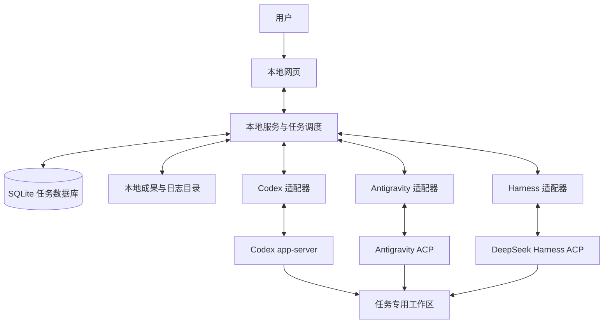

# 多 AI 协作工作台 v0.1 项目方案

版本：v0.1 修订草案（吸收两份早期构想）  
日期：2026 年 11 月 9 日  
运行方式：代码放 GitHub，软件在本机运行  
首批接入：Codex、Antigravity、DeepSeek Harness

阅读建议：第 1—3 节说明产品怎么用，第 5 节说明三家怎么接入，第 9—10 节可直接用于安排开发和验收。其余部分供实现时查阅。

## 1 这个项目要做什么

做一个本地网页，让你在一个地方给不同的 AI 分工、查看进度、检查成果，并决定是否通过验收。

长期愿景是一家供自己使用的“AI 公司”：你负责目标和关键决定，AI 以可保存的员工身份承担不同职责，并积累经你确认的工作规则与经验。v0.1 先围绕本地 Git 项目中的代码与文档任务，把这套工作方式做成；通用调研、群聊和更多岗位以后再扩展。

例如，你提出“给这个项目增加导出功能”，让 Codex 写代码，让 DeepSeek Harness 检查实现，让 Antigravity 补充复核。工作台保存任务、负责人、实际改动和检查结果。你不用在三个窗口之间反复复制消息，也能看清工作到底有没有完成。

**v0.1 的重点是把一次协作做可靠：任务不丢、状态不乱、重复发送不盲目重做、最后由你验收。** 首版不追求让一群 AI 无限制地互相聊天。

这里接入的是各家的 agent 工具及其执行能力，不是只给三个模型 API 套上聊天框。各工具的登录、模型可用性、额度和原生权限仍按各自规则工作。本地运行也不等于离线推理，调用模型通常仍需要网络。

产品中区分三个概念：**员工是可复用的角色档案，agent 工具提供执行能力，模型是该工具实际使用的模型。** 用户按职责选人，再在工具支持范围内选择模型；不预设永久主助手，也不把某个品牌固定为管理者或复核者。

### 借鉴哪些优点

| 来源 | 借鉴内容 | 本项目中的落点 |
| --- | --- | --- |
| Bench | 围绕任务组织分工、交接和验收 | 任务看板、明确负责人、人工验收 |
| Agent HUD | 把不同工具接到同一个面板，并记录投递回执 | 每家独立适配、显示真实能力、保留发送和执行记录 |
| Grok Bot | 让 AI 有持续的职责和可复用的工作方式 | 可保存的角色说明、项目规则和交付清单 |

以上是设计取舍，并不意味着直接组合三个项目的代码。[Bench 项目](https://github.com/Sword-New-New/Bench)、[Agent HUD 消息机制](https://github.com/jazzenchen/agent-hud-open/blob/main/docs/agent-messages.md)、[Grok Bot 的角色与工作方式](https://prod.cursor.com/docs/grok-bot/work)。

本次修订另参考《多模型 Agent 协作平台：设计构想（改进版 v0.2）》和《AI 虚拟公司：个人多模型 Agent 协作平台项目总结》。它们用于补充产品构想，不作为第三方协议能力已经验证的证据。

| 两份构想中的建议 | v0.1 的取舍 |
| --- | --- |
| 长期员工、身份与模型解耦 | 保存角色档案；换工具后仍保留身份与历史，执行会话单独管理 |
| 全局、群、员工的分层记忆 | 先做用户维护的全局、项目、角色规则与经验；群层以后再加 |
| 群负责讨论、任务负责交付、共享文件柜 | 先做任务内讨论和成果区；讨论不自动派单，成果按版本共享 |
| 待办收件箱、成本与制动入口 | 看板汇总待处理事项、显示可取得的用量、提供全局暂停派单 |
| 招聘助手、智能路由、圆桌讨论、自动记忆整理 | 留到可靠交付流程完成后，再逐项验证和引入 |

## 2 首版的边界

### 必须做成

- 单人使用，优先支持 Windows；工作台的数据存储位于本机。
- 添加本地 Git 项目，绑定允许 AI 工作的目录。
- 接入三种 agent；分别显示是否可用、能做什么、是否正在等待用户。
- 创建任务，填写目标和验收条件，指定一个执行者及可选复核者。
- 保存进度、问题、成果版本、复核意见和用户验收记录。
- 支持暂停派单、请求停止、失败后人工重试，以及服务重启后的恢复核对。
- 提供实现者、代码复核者、验收检查者三个模板，可保存为有名称、职责边界和默认工具的角色档案，并可停用。
- 保存用户确认的全局、项目、角色规则与经验，保留版本、来源和本轮采用的内容。
- 在现有页面中提供任务讨论、成果区和待处理事项汇总，明确哪些操作正在等待用户。

### 首版不做

- 云端部署、多人账号、跨电脑协作和手机端。
- 自动接管所有已打开的桌面聊天，或扫描用户全部历史会话。
- AI 自由招募其他 AI、无限派生任务、无限讨论或自动反复返工。
- 自动合并代码、推送 GitHub、发布版本和部署服务。
- 定时任务、复杂长期记忆、插件市场、精确的跨厂商费用结算。
- 独立群聊与私信系统、自动主持人路由、HR 招聘助手、员工绩效排名、向量检索与自动记忆晋升。
- 把不稳定的客户端内部接口作为必需依赖。

GitHub 在 v0.1 中用于存放本项目代码、文档、Issue 和版本发布。运行工作台不需要 GitHub Token。把软件代码放到 GitHub，不会自动上传用户的项目、聊天或登录信息。

## 3 用户实际怎么使用

1. 启动工作台，在浏览器打开本地页面。
2. 选择一个本地 Git 仓库。工作台检查目录、Git 状态和三种工具的可用性。
3. 创建任务，例如“增加 CSV 导出”，写明验收要求，例如“中文不乱码、筛选条件生效、提供测试结果”。
4. 从角色档案指定实现者和复核者；也可从默认模板生成档案后使用。首次运行前展示本次工具、可确认的模型、规则版本、允许的目录、操作范围和流程。
5. 实现者在任务专用工作区完成修改，提交成果。工作台记录改动、基准版本和执行证据。
6. 复核者检查固定版本的成果，提交问题清单。需要返工时，由用户确认重新执行。
7. 用户查看差异、测试结果和复核意见，选择通过、返工或暂缓。

“通过”表示用户接受这一版成果，不会顺便把代码合并到主分支。是否合并、提交或推送由用户另行处理。

任务结束后，用户可以把有价值的经验手动保存到项目或角色配置。复盘可以作为任务记录保留；保存为长期规则是另一个明确操作，不自动触发新的模型调用或后续任务。

首版只需要三个主要页面：

| 页面 | 用户应该看到什么 |
| --- | --- |
| 项目与连接 | 项目目录、工具状态与能力、角色档案、全局及项目规则；角色详情中维护其经验 |
| 任务看板 | 六种任务状态、待处理事项汇总、全局暂停派单入口 |
| 任务详情 | 目标、负责人、讨论与执行记录、问题与审批、成果区、复核意见、验收按钮、本轮规则与可用的用量记录 |

活动记录必须标清“用户发出”“AI 汇报”“工具确认”。例如，“AI 说测试通过”和“已收到测试命令退出码及输出”是两种不同的证据。

待处理事项汇总原生审批、用户提问、待核实执行和待验收成果；它是已有记录的入口，不另建一套状态。每项显示所属项目、任务、执行及阻塞原因，点击后进入对应操作。原生权限批准、普通问题回答和成果验收保持各自的类型与有效期检查，不提供混合的“一键全部通过”。

任务详情中的讨论用于补充背景和解释决定，长篇文档、代码及报告放在成果区，消息引用具体成果版本。首版不提供自动群聊；`@员工` 只是提及，只有明确的派单、回答或返工操作才会推进执行。用户在讨论中提出目标变更时，需保存为任务变更；活动执行受影响时先暂停后续派单、核对并停止原执行，再由用户决定新一轮工作。

### 角色档案怎样复用

角色档案保存稳定编号、名称、职责、交付清单、表达偏好、权限需求、默认工具及可选模型。负责人是任务的属性；同一档案可以在不同任务中承担不同职责，但每次启动都要验证所选角色要求的实际权限。

修改默认工具、模型或职责只影响后续执行。已开始的执行保留当时的档案版本、绑定、权限配置与实际可确认的模型；未知模型明确标为未知。切换工具要先确认原执行结束，再建立新执行和必要的专用会话，通过工作台保存的上下文交接，不承诺迁移原生隐藏状态或跨工具继续同一会话。

停用档案后不能再给它派新执行，已排队但未发送的执行暂停，等待用户重新启用或调整负责人；已经发送的执行按正常停止或结束流程处理，历史成果和归属保留。首版不做试用期、晋升或绩效系统。

### 首版怎样保存规则和经验

采用轻量的分层配置，不另建自主记忆服务：

| 层次 | 保存什么 | 使用范围 |
| --- | --- | --- |
| 全局 | 用户确认的通用要求和表达偏好 | 用户允许应用这些规则的所有项目 |
| 项目 | 项目约定、背景和经确认的经验 | 当前项目 |
| 角色 | 职责、风格和经确认的经验 | 当前角色；来自具体项目的经验默认只在原项目使用 |
| 任务记录 | 目标、决定、问题、证据与成果引用 | 当前任务，不自动晋升为长期规则 |

首版由用户编辑或从任务记录选取内容后确认保存，AI 只能建议；不自动从全部聊天中提炼记忆。长期条目区分规则、偏好、事实和经验，保存作用范围、来源、版本及确认时间。扩大项目经验的使用范围也需要用户明确确认，不能因同一员工参与多个项目就自动带出项目资料。

权限边界始终由本地服务与原生工具执行，不能被任何一层文本扩大。内容冲突时，用户在任务设置中明确确认的要求优先，其次是全局规则、项目约定、角色默认偏好；若要例外覆盖全局规则，需记录例外的具体内容和范围。无法判断的冲突交给用户处理，不由 AI 默默改写规则。

SQLite 保存正式版本，界面支持查看、编辑和导出 Markdown，保留来源及版本信息。外部编辑的 Markdown 可以导入为待确认变更，经差异检查和用户保存后生效；不将磁盘文件与数据库都设为可独立生效的来源。修改或回退会形成新版本，后续执行采用；运行中的执行不热更新，也不通过编辑 Markdown 绕过权限设置。

## 4 整体结构

首版使用一个本地服务管理所有任务。浏览器负责展示，本地服务负责记录和派单，适配器负责与各家工具通信。



图中表示工具都能访问分配给自己的工作区，不表示三个 AI 同时修改同一份文件。

建议采用 TypeScript 编写服务、网页和适配层；网页使用 React，服务使用 Fastify，数据库使用 SQLite。浏览器通过 HTTP 提交操作，通过 SSE 接收进度。本地服务可以拉起独立的工具进程，但不需要再拆出云端连接器、消息中间件或多套数据库。

依赖版本在第一轮兼容性验证后锁定，提交依赖锁文件。运行时选择当时受支持的 Node.js LTS，不能在生产安装说明中长期使用不固定版本的 `latest`。

角色配置、规则版本和本轮上下文组装由现有服务与 SQLite 承担，首版不增加独立记忆进程、向量数据库或用于自动派人的额外模型。配置留在本机，但传给原生 agent 的任务内容和规则可能随模型请求发送到其服务商；运行前可查看本轮内容与来源。

服务只监听回环地址。关闭网页不代表任务停止；退出本地服务前应提示仍在运行的任务。电脑休眠、关机或工具断线后，先核对原执行，再决定如何继续。

## 5 三种 agent 如何接入

### 共同原则

每家工具都需要一个“翻译器”，把本项目的派单、进度和停止操作转成该工具支持的协议。三家可以使用不同协议，但回到工作台时遵守同一份任务规则。

优先使用官方公开接口。首版统一创建工作台专用会话，只恢复本工作台登记的会话，不接管已有桌面聊天。不能为了复用聊天记录，偷偷在另一套执行引擎里恢复同一个会话。

| 工具 | v0.1 主通道 | 用户需要准备 |
| --- | --- | --- |
| Codex | 官方 app-server | 安装并完成 Codex 登录 |
| Antigravity | 官方 CLI 的 ACP 模式 | 安装 CLI，完成登录，确认当前账户可用模型 |
| DeepSeek Harness | 官方 ACP profile | 安装 Harness，配置该 profile 的模型与认证 |

适配器必须分别报告“已验证支持”“不支持”“未验证”。没有确认停止能力，就不能显示一个看似有效的停止按钮；不能读取真实进度，就显示“等待结果”，不能编造运行百分比。

### Codex

**主通道采用官方 `codex app-server`，由工作台管理专用会话。** 官方协议提供线程、轮次、事件和审批能力，适合被另一个应用接入。[Codex App Server 文档](https://learn.chatgpt.com/docs/app-server)

实施约定：

- 使用 `initialize`、`initialized` 完成连接初始化，使用 `thread/start` 建立会话，再用 `turn/start` 派发一轮工作。
- 只登记和恢复本工作台管理的线程。首版不依赖桌面 App 的私有 IPC，也不使用其他项目中出现但未经当前公开协议确认的队列接口。
- 本工作台维护发送队列。同一会话前一轮未结束时，后一条任务等待，不在首版实现中途插话。
- 保留用户及组织的生效权限配置，不自动把审批改成“全部允许”。模型由用户选择或沿用当前配置。
- 原生审批和问题按请求类型显示，回传用户决定。命令审批、文件修改审批和普通提问不能混成一种回复。
- 请求中断时关联具体线程和轮次；收到结束证据后，才显示已停止。

原生方法和字段须从锁定版本的协议类型生成或校验。本项目的 `submit` 等内部方法名不等于 Codex 原生方法名。[官方请求类型](https://github.com/openai/codex/blob/main/codex-rs/app-server-protocol/schema/typescript/ClientRequest.ts)

### Antigravity

**主通道采用官方 `agy acp`，由工作台启动独立 CLI 会话。** ACP 是外部应用与 agent 交换任务、进度和权限请求的协议。Antigravity 的官方文档说明了通过标准输入输出使用该协议的接入方式。[官方 ACP 指南](https://antigravity.google/docs/ide/extensions/acp/)、[CLI ACP 入口](https://antigravity.google/docs/cli/acp/)

实施约定：

- 按启动协商结果确定可用能力，映射任务输入、流式消息、权限请求、会话标识和结束状态。
- 最小调用流程为 `initialize → session/new → session/prompt`；通过 `session/update` 收进度，通过 `session/request_permission` 处理授权，通过 `session/cancel` 请求取消。恢复等扩展只在协商确认后启用。[ACP 协议](https://agentclientprotocol.com/protocol/v1/prompt-turn)
- 首版创建专用会话，不承诺接管用户正在 IDE 中使用的聊天，也不依赖探测内部 language server。
- 官方文档对不同客户端的模型可用范围有区别；本项目只展示实际可用模型，不承诺自制客户端可调用 Antigravity 中的全部第三方模型。
- 优先使用可处理交互式审批的 ACP。普通无界面命令执行成功退出，不足以证明任务完成或所有请求都获准。
- Windows 的安装和协议运行必须单独实测；提供官方 Windows 安装入口不等于本项目适配已经验证。[官方下载入口](https://antigravity.google/download)

如果用户以后特别需要接入已有 IDE 会话，可以另做 MCP 配合模式。MCP 可以让 agent 调用工作台提供的任务工具，但不天然保证唤醒已经停止的会话。[官方 MCP 文档](https://antigravity.google/docs/mcp)

### DeepSeek Harness

**主通道采用官方 ACP profile，由工作台创建专用会话，首版不要求安装会话转发插件。** 官方 CLI 提供 `dsh --profile acp`，源码开发环境使用仓库对应的启动脚本。它与 Antigravity 都使用 ACP，但支持的扩展和返回内容并不完全相同。[Harness CLI 说明](https://github.com/deepseek-ai/deepseek-harness/blob/master/docs/cli-help.md)

实施约定：

- 建立会话后通过 `session/prompt` 发任务，以 `session/update` 收到的消息和工具事件展示进度；每个会话只派发一轮。
- 权限请求接到工作台，由用户选择本次允许或拒绝；按 `toolCallId` 关联工具详情，不能因为协议允许客户端自动回答就默认放行。[权限请求实现](https://github.com/deepseek-ai/deepseek-harness/blob/master/packages/acp/acp/src/index.ts#L143)
- `session/resume` 不重放旧事件，也不提供 `session/load`；工作台必须保存自己的事件与成果，无法补齐的历史如实标记缺口。
- `session/cancel` 取消当前活动，但晚到的子任务消息可能再次触发工作。停止整个任务时，需要调用已协商支持的 `session/close` 并确认专用会话及其后代结束，才释放占用。
- ACP 模式不提供 Harness 全部界面功能。原生计划卡片、终端视图、交互式提问表单不照搬进工作台；需要向用户提问时使用本项目的提问入口。

以上能力和限制来自官方 ACP 契约，必须针对锁定版本验证。[Harness ACP 文档](https://github.com/deepseek-ai/deepseek-harness/blob/master/packages/acp/acp/README.md)

ACP profile 的模型、权限和工具配置独立核对，不能声称完整继承某个 Web 会话的预设。官方基础配置包含 Windows 执行路径；发布前仍需做 Windows 实测。安装说明应说明所选 profile 的联网与数据收集配置，不能将“工作台存储在本机”表述为“第三方工具绝不传出数据”。[Harness 基础配置](https://github.com/deepseek-ai/deepseek-harness/blob/master/packages/bundle/base/README.md)

### 接入能力记录

第一阶段输出 `docs/compatibility.md`，为每个适配器填写：操作系统、工具版本、启动方式、登录前提、创建会话、发送任务、审批、读取结果、停止、恢复、限制，以及验证日期。

另外记录模型选择与实际模型回报、规则及任务上下文的传入方式、用量字段及统计口径。无法取得的字段标为未知或不支持，不通过猜测补齐。用量回报是可选能力；目录权限、结果核对等必需能力仍按各角色要求验收。

三家都必须完成真实的“派单 → 执行 → 产物 → 结果回传”。只连通端口、只跑模拟适配器或只收到一条聊天消息，都不能算接入完成。

## 6 怎样保证协作可靠

### 任务记录是依据

AI 可以提出计划、申请交接、报告完成，但程序决定这些操作是否有效。数据库里的负责人、执行编号、成果版本和用户验收记录才是依据。

v0.1 允许 AI 建议拆分任务，由用户确认后再创建。普通聊天中的 `@某个AI` 不自动产生可执行派单，防止一句讨论话触发文件修改。

### 每轮执行带上明确的上下文

派单和交接不要求用户来回复制完整聊天。服务为每个执行保存一份上下文快照，包括目标与验收条件、角色和规则版本、用户已确认的决定、允许的目录与操作、成果版本及证据引用、尚未解决的问题。每项标明来源；AI 总结是辅助说明，不能替代原始证据或变成用户授权。

只传本任务所需且允许共享的内容，不默认注入所有员工经验或其他项目聊天。规则、权限范围和验收要求不能因上下文过长被静默截断；放不下时缩减参考材料或提示用户处理。长篇材料以摘要与可访问的文件引用交接，引用必须对应保存的版本。快照记录实际传入内容，不声称完整复制第三方工具的内部记忆。

### 发出与完成分开

| 层次 | 需要记录的状态 | 含义 |
| --- | --- | --- |
| 任务 | 待分配、执行中、被阻塞、待验收、已完成、已取消 | 用户关心的工作进展 |
| 一次执行 | 排队、发送中、已接受、运行中、等待用户、成功、失败、停止中、已停止、待核实 | 这一轮 agent 实际进行到哪一步 |
| 连接 | 可用、离线、待恢复 | 工具能否联系上，不直接改变任务完成状态 |

一个任务可以有多次执行。AI 结束一轮，只说明这一轮结束。实现者提交合格成果后，没有指定复核者的任务进入待验收；有指定复核者的任务仍为执行中，所有指定复核结束后才进入待验收。复核提出问题属于待用户判断的结果；复核本身运行失败则进入被阻塞。用户可以明确记录跳过某次复核，程序不能默默跳过。只有用户可以把任务设为已完成。

“成功”需要原生正常结束证据；如任务要求交付文件，还必须检查文件或差异存在。对测试是否充分、结果是否正确，仍需复核与验收。

### 先保存再发送

1. 用户操作携带稳定请求编号。数据库在同一事务里保存任务变更和待发送指令。
2. 调度器读取待发送记录，先记为发送中，再调用适配器。
3. 原生工具明确接受后，保存原生会话及可用的轮次标识，再更新为已接受。没有独立接收回执的协议，等待有效运行事件；写入通信管道不算已接受。
4. 收到进度和终态后，先落库，再通知网页。
5. 重复请求沿用原编号；同编号、同内容返回原记录，同编号、不同内容明确拒绝。

如果服务在“工具可能已经收到，但本地还没记下结果”的瞬间崩溃，恢复后标记待核实。能够查到原执行就继续跟踪；不能查清就请用户处理。**不能因为超时，就换一个编号再执行一次。** 本项目不承诺外部副作用在任何故障下都绝对只发生一次。

本工作台的稳定请求编号用于自身去重；原生 JSON-RPC 请求编号通常只用于关联请求与回复，不能据此假定三家工具都能跨重启自动去重。ACP 的 `session/prompt` 最终响应与中途进度也要分别处理，不能等待最终响应才开始显示执行状态。

### 交接不能让旧负责人继续改状态

任务保存当前负责人、负责人代次和记录版本。负责人改变才增加负责人代次；同一负责人返工则创建新的执行编号。所有进度、交接及成果提交都必须对应有效执行。

负责人指向稳定的角色档案，具体原生绑定和会话属于执行。换工具但保留同一负责人时不增加负责人代次，仍必须创建新执行；旧执行事件不能因员工身份相同而继续修改当前状态。

换负责人前，必须确认旧执行已结束。无法确认就冻结原任务，不派新负责人；用户若要另做独立工作，应创建不同任务并使用独立工作区。数据库拒绝旧负责人迟到的状态修改，但这不能阻止仍在运行的旧进程继续写文件，所以不能只靠修改负责人字段完成交接。

### 复核固定版本的成果

实现者是任务负责人；复核者使用单独的复核执行，检查一份固定成果。复核不会抢走编码负责人的身份。

成果由基准提交、补丁或快照、文件清单和摘要组成，带唯一版本及哈希。复核者不能直接检查一份还在持续变化的目录。只读模式必须由工具配置或受限执行环境落实；仅在提示词中写“不要修改”不算只读保障。暂不支持可靠只读的接入方式，不能参与自动只读复核。

返工时创建新的执行；提交后生成新的成果版本。旧复核保留为历史，不能冒充对新成果的结论。用户验收也要指明成果版本，旧页面的“通过”不能意外批准新成果。

建议在能力和权限满足的前提下选择不同工具或模型进行交叉复核，但不把模型不同当成质量保证。多名复核者先对同一成果独立给出结论，再向用户汇总；首轮输入不附其他复核者的结论。意见冲突时列出对应证据和影响，由用户决定，不按多数票自动通过，也不自动发起争论或返工。

### 停止要等到有结果

“停止任务”先冻结后续派单，取消尚未发送的执行，再请求停止这个任务已启动的执行和已登记子执行。只停止能够明确归属本任务的轮次，不关闭整个客户端。

请求发出后显示“停止中”。只有确认执行已经结束，才显示“已停止”。确认不了就显示“停止结果待核实”，保留工作区占用；不能立刻让另一个 AI 接手同一目录。

停止不撤销已有文件改动。迟到的消息仍可存档，但不能触发新的复核或返工。把任务正式取消是另一个用户操作；仍有执行未确认结束时，记录取消意图并显示待核实，不能直接显示整个任务已经取消。

“全局暂停派单”持久保存调度开关，阻止所有新的实现、复核和重试发送，包括已经排队的指令；恢复派单需用户明确操作。暂停不等于终止已发送的工作。另提供“请求停止全部活动任务”，先设置全局暂停，再对本工作台管理的执行逐一走上述停止流程，汇总仍待核实的执行和占用，不影响未登记的其他客户端会话。

### 自动化有明确上限

首版每个 agent 会话最多同时执行一轮，每个任务最多一个写代码的执行。可并行检查不同任务或固定成果，但不能并行修改同一工作区。

工作台不开放自动派生任务。若启用工具自身的子代理，适配器必须能追踪其归属并验证停止范围；做不到时关闭该项能力，不能允许未登记的后台工作继续占用项目。

一次用户确认的流程最多包含一次实现和两次复核。发现问题后暂停，等待用户决定返工。提供执行时长提醒和停止入口；超时只触发核对或停止请求，不直接宣称已失败、已停止或自动重跑。

### 用量可见，限制按实际能力落实

首版记录执行次数、持续时间和工具实际提供的 token 用量，保留来源、统计范围及完整性标记。拿不到用量时显示未知；不同工具的字段不能直接当成可比费用。金额仅在有明确计价依据时显示为估算，不推算订阅余额或承诺精确账单。

本地调度器强制执行流程步数和并发上限。用户可设置时间或已报告用量的提醒阈值，触发后冻结该任务的后续派单，并按用户预设请求停止；原生执行仍须等结束证据。用量可能延迟或缺失，故首版不承诺严格金额封顶；未知用量不能显示为零或“仍在预算内”。

## 7 文件和权限怎么处理

每个写代码的任务使用独立 Git worktree，也就是同一仓库的一份独立工作目录。首版要求选择明确的已提交基准；仓库有未提交修改时，提示用户先处理，不能自动覆盖或丢弃。

工作台保存工作区分配关系，禁止两个写执行占用同一路径。任务结束后保留成果；删除工作区和归档数据需用户明确操作。代码合并不属于“验收通过”的附带行为。

“共享成果区”是用户与获授权复核者查看固定版本的入口，不是所有员工可同时写入的公共目录。不同任务独立占用工作区，跨任务引用成果须由用户明确选择并记录来源与版本，不能因角色相同自动开放访问。

任务数据库、身份凭证和内部队列放在应用数据目录中，不放进 AI 正在修改的项目仓库。成果文件另存并计算哈希。数据库只引用已经成功保存的成果；未完成的临时文件可以清理，已提交成果不能因日志轮转被删除。

本地服务也要区分用户和 AI 的权限：

- 网页使用本机会话凭证，并校验 Origin、Host 和防跨站请求标记；不把“来自 localhost”当作已授权。
- agent 使用按项目、会话和执行范围限制的凭证，不能调用用户验收、权限设置或审批接口。
- 身份由适配器或独立 MCP 桥接进程绑定，模型不能在参数中填写“我是用户”或冒充另一个项目的 agent。
- 文件操作先解析真实路径，再检查项目范围，防止相对路径或符号链接绕过目录限制。
- 不把聊天文本直接拼接成 Shell 命令；以明确程序路径和参数数组启动工具。
- 日志隐藏密钥和凭证。沿用各工具正常登录，不复制或上传其登录文件。
- 网页、附件、源码和 AI 消息属于带来源的参考内容，其中的自称指令不能自动变成派单、审批、长期规则或跨项目授权。编排层仅接受经过身份与状态校验的操作，参考文本与用户确认的任务要求分别传入。

原生工具的实际权限必须同时满足用户及组织规则、本次任务目录和角色范围。需要更严格限制时，只能缩小权限；工具无法落实所需限制，就拒绝启动该角色。工作台的路径检查只能约束经过工作台的文件操作，原生 agent 自己执行的 Shell 和文件工具还需要各自的权限机制，不能把两者混为一谈。

这些机制用于防止误操作和串任务；在同一个系统账号下运行的 agent，不因此获得强隔离。v0.1 不定位为运行恶意程序的安全环境。

## 8 给开发者的最小技术约定

### 数据对象

| 对象 | 最少需要保存的内容 |
| --- | --- |
| Project | 项目编号、允许的真实路径、Git 基准、规则版本引用 |
| RoleProfile | 稳定员工编号、档案版本、名称、职责与交付清单、表达偏好、权限需求、默认工具与可选模型、停用状态 |
| RuleRevision | 条目编号、版本、层次与类型、作用范围、内容、来源、用户确认记录及被替代版本 |
| AgentBinding | 工具种类、版本、能力、原生会话标识、绑定项目 |
| Task | 目标、验收条件、状态、负责人档案编号、负责人代次、记录版本、已确认流程与限制、派单是否冻结 |
| Run | 执行编号、任务、实现或复核角色、档案版本、绑定编号、上下文快照与哈希、权限配置、可确认的模型、工作区、尝试编号、状态、连接代次、可空的原生轮次标识、用量及来源 |
| Command | 稳定请求编号、参数摘要、目标、待发或投递结果 |
| Event | 唯一事件编号、执行编号、本地递增序号、来源、原始关联标识 |
| Artifact | 成果版本、基准、路径、哈希、生成执行、证据类型 |
| Review | 被复核成果版本、复核执行、问题与建议 |
| Approval | 原生请求标识、关联执行、请求内容、用户决定、是否已失效 |
| Question | 稳定问题编号、关联执行、原生或桥接来源、问题、回答、有效状态及回传结果 |
| Acceptance | 用户决定、对应成果版本、时间、意见 |

任务讨论和用户决定沿用 Event 存储，未关联具体执行时执行编号可空，不能据此修改运行状态；执行事件仍必须关联有效 Run。待处理事项从 Approval、Question、Run 与 Artifact/Acceptance 等记录派生。全局暂停开关持久保存，调度器在“排队 → 发送中”的同一事务中检查全局及任务开关、档案启用状态、流程额度并更新执行占用；与暂停、停用操作串行裁决，恢复后不能绕过限制。暂停确认后不再允许排队指令进入发送中；此前已进入发送阶段但回执未明的执行继续核对，不伪装成尚未发送。

SQLite 开启外键和 WAL；状态变更使用事务及版本条件更新。稳定请求编号设置唯一约束。首次执行与重试区分清楚：重发投递沿用同一编号，用户决定重新做才生成新的执行编号。

这里的编号去重首先作用于工作台收到的重复操作。对原生工具，只有确认未发送或未被接受时，才允许再次投递；只要存在已经接受的可能，即使编号相同也必须先核对，不能自动重发。

### 适配器内部接口

以下名称是本项目自己的接口，不是三家工具的通用原生 API。

| 方法 | 责任 |
| --- | --- |
| `probe` | 检查安装、登录前提、版本与实际能力 |
| `openSession` | 创建专用会话，或恢复本工作台登记的会话 |
| `submit` | 发送带稳定请求编号的任务，返回接受、拒绝或结果不明 |
| `observe` | 提供进度、审批、问题和终态事件 |
| `inspectRun` | 核对原执行是否存在、当前状态及可恢复信息 |
| `respond` | 回答特定原生提问或审批，检查请求仍有效 |
| `cancel` | 请求停止明确的执行，返回请求状态，不直接宣称已停止 |

未支持的能力返回明确错误，不允许空实现返回成功。`inspectRun` 可以返回无法确认；它的存在不表示每家都支持完整断点恢复。

### 事件与恢复

事件统一包含 `eventId`、`projectId`、`taskId`、`runId`、`bindingId`、本地 `seq`、事件类型、来源和原生标识。任务级讨论允许 `runId`、`bindingId` 和原生标识为空；执行进度、审批及成果事件必须关联实际执行与绑定。身份字段由服务端补全并校验，不能相信模型填写的值。

ACP 没有可以统一当作 Codex `turnId` 使用的持久轮次标识。ACP 适配器使用本地 `runId`、连接代次和当前在途 prompt 关联消息，JSON-RPC id 仅作请求关联。适配器把 `session/prompt` 的最终响应及 `stopReason` 转成内部终态，分别处理正常结束、取消和协议错误；不能假设 `session/update` 一定包含独立结束事件。

页面重连可以按本地 `seq` 补读已保存事件。工具端断连则调用各家真实存在的查询能力核对；不能由此假设原生协议支持任意事件重放。缺失进度显示缺口，不能补造日志。

服务启动时先核对所有非终态执行，释放已确认结束的锁，冻结结果不明的工作区。离线和超时都不能自动产生新的执行者。

### MCP 协作与用户提问

MCP 作为 agent 主动查询任务和回报结果的统一入口，可提供 `get_task`、`report_progress`、`submit_artifact`、`request_handoff`。这些辅助工具可逐步增加，发送任务仍走各适配器的主通道。

没有原生提问通道的适配器，必须提供最小 `ask_user` 桥接，保存问题并提供答案回传，Harness 首版即有此要求。等待期间任务显示等待用户，不把提问当完成结果；不能因通信超时重复生成同一个问题。只有该通道可用后，才能把等待用户能力标为支持。

工具调用的权限来自当前绑定，不开放“批准自己”“验收自己”或“随意给其他 agent 派单”。即使没有 MCP 进度回报，适配器也应通过原生结束事件或最终响应识别一轮执行是否结束；缺少必需成果时进入被阻塞或待补交，不能无条件完成。

### 项目目录建议

```text
apps/
  web/                    本地网页
  server/                 HTTP、事件推送和启动入口
packages/
  core/                   状态规则、调度、权限、验收
  db/                     数据结构、迁移、事务与恢复
  adapters/
    codex/                Codex app-server
    antigravity/          Antigravity ACP
    deepseek-harness/     Harness ACP
  protocol/               公共类型和参数校验
  mcp/                    必需的提问桥接与可选协作工具
docs/
  PROJECT_V0.1.md
  architecture.md
  compatibility.md
  testing.md
tests/
  integration/
  fixtures/
```

核心模块不能依赖任何厂商专用类型。适配器把原生事件转成公共事件，网页不直接读取厂商日志或猜测客户端状态。

## 9 可以直接拆成 GitHub Issue 的开发顺序

| 顺序 | Issue 标题 | 完成条件 |
| --- | --- | --- |
| 1 | 验证三种工具的真实接入能力 | 三家各完成最小真实任务；实测 Windows 下只读复核、目录限制、子执行关闭和提问回传；锁定兼容版本 |
| 2 | 建立本地服务与数据库 | 能启动网页，保存项目、角色档案、规则版本和任务，完成迁移及重启恢复机制 |
| 3 | 实现身份和任务状态规则 | 权限、版本、唯一请求、负责人代次由服务端验证；规则作用范围及上下文快照可追踪 |
| 4 | 实现持久派单和故障恢复 | 在发送前后各崩溃点测试，不丢任务、不盲目重复执行；验证全局暂停及流程上限 |
| 5 | 完成 Codex 适配器 | 专用会话、队列、事件、原生审批、停止和恢复核对 |
| 6 | 完成 Antigravity 适配器 | ACP 会话、权限、流式结果、取消和能力记录 |
| 7 | 完成 Harness 适配器 | ACP 专用会话、权限、语义事件、取消与关闭、恢复限制处理 |
| 8 | 实现工作区与成果版本 | 独立目录、基准与补丁、哈希、固定版本复核 |
| 9 | 完成任务页面与人工验收 | 三页内完成角色与规则编辑、Markdown 导入导出、讨论与成果区、待处理事项、真实用量或未知状态展示；返工、停止和待核实操作清楚可见 |
| 10 | 完成端到端验收与发布文档 | 真实三家协作、故障测试、安装说明、已知限制、兼容性记录齐全 |

Issue 1 是后续适配器设计的前置条件，不能把接口验证留到界面完成以后。Issue 5—7 可并行开发，但必须使用 Issue 3—4 确定的公共规则。

内部联调先跑通“一名实现者 → 一名复核者 → 用户验收”，再扩展到两名复核者和三家真实接入。这个切片用于缩短验证周期，不降低 A01、A02 的首版发布门槛，也不以多模型群聊演示替代实际交付。

仓库建立后提供 README、贡献说明、许可证、Issue 模板和 CI。CI 默认使用模拟适配器测试状态与故障，不依赖个人账号和付费模型。真实客户端测试作为发布前单独验收，不把登录凭证放进公开 CI。

开发入口目标为“安装依赖后启动本地网页”，发布入口目标为“一个启动命令同时启动页面和服务”。具体命令随仓库脚本一起交付，不能在尚未实现时宣称已经可以一键安装。

## 10 v0.1 验收清单

以下都是发布门槛，不是已经完成的测试结果。

| 编号 | 场景 | 必须满足的结果 |
| --- | --- | --- |
| A01 | 三家真实接入 | 每家实际完成任务并留下可检查的产物、版本和执行证据 |
| A02 | 一次完整协作 | Codex 实现、Harness 与 Antigravity 复核固定成果、用户验收，全程可追踪 |
| A03 | 重复提交 | 同编号同内容只有一份有效记录；同编号不同内容被拒绝 |
| A04 | 并发派单 | 同一任务不能有两个有效写执行，同一工作区不能被并行占用 |
| A05 | 发送前崩溃 | 重启后待办仍在，任务与待发送指令不存在缺一项的情况 |
| A06 | 发送后确认丢失 | 不盲目再启动；能核对原执行，或明确显示待核实 |
| A07 | 迟到与重复事件 | 旧执行不能覆盖新负责人，重复事件不重复改变状态，终态不退回运行中 |
| A08 | 停止 | 先显示停止中；未确认结束不释放工作区，不影响无关会话 |
| A09 | 原生审批与待处理事项 | 汇总入口能定位具体请求，回答类型正确；完成或失效事项同步更新，过期请求不能被再次批准 |
| A10 | 身份、项目与参考内容边界 | 工作台接口拒绝跨项目和越权操作；附件、消息中的指令不能自动派单或改变授权；另行验证原生文件与 Shell 权限限制，不用接口检查替代进程权限测试 |
| A11 | 成果版本 | 返工后旧复核不能覆盖新成果，旧页面不能批准新版本 |
| A12 | 离线与重启 | 任务可恢复查看，结果不明的执行不会自动换人或自动重做 |
| A13 | 证据真实性 | 排队不显示完成，退出码为零不自动等于满足验收，AI 自述有来源标记 |
| A14 | 本地页面保护 | 来自其他网站的写请求被拒绝，agent 凭证不能调用用户专属接口 |
| A15 | 文件与数据保存 | 未提交修改不被覆盖，活动任务不会被历史清理删除，数据库和成果可备份恢复 |
| A16 | 不支持的能力 | 明确显示限制，不出现伪成功的停止、恢复或只读操作 |
| A17 | 角色与执行分离 | 改默认工具或模型不改写旧执行；停用档案保留历史并阻止新派单及排队发送；换工具后旧事件不能影响新执行 |
| A18 | 规则确认与作用范围 | 未确认内容不进入正式规则；导入需检查差异并确认，回退保留版本；项目经验不因复用角色泄露到其他项目，运行中快照不随编辑改变 |
| A19 | 上下文交接与独立复核 | 执行可追溯采用的规则、用户决定和成果版本；长材料不挤掉验收条件；两名复核者独立检查后汇总，分歧不触发自动重跑 |
| A20 | 全局暂停与用量限制 | 暂停状态重启后保留；并发暂停与发送只按裁决结果推进，在途执行继续核对；停止全部逐项确认；流程上限无法被并发或重启绕过，用量缺失显示未知，阈值触发不冒充执行已停止 |

如果某家工具只能收消息、无法交付和核对结果，则该适配器仍属实验状态，不能将“三家协作已完成”写进发布说明。代码复核能力未通过时，也不能用提示词代替权限检查来通过 A02。

备份应使用 SQLite 的一致性备份机制或在服务停止后备份，并一并保存成果文件与版本清单。不能只复制正在写入的主数据库文件而忽略相关状态。数据库升级前备份，升级失败时停止启动并保留原数据。

## 11 后续版本再考虑什么

后续优先延伸个人“AI 公司”的工作方式，按实际使用需求推进，不把以下内容一起承诺为 v0.2：

| 方向 | 引入前提与边界 |
| --- | --- |
| 群与圆桌讨论 | 任务交付已稳定；显式启动、限定参与者和轮数，讨论结论经用户确认才能派单 |
| 记忆建议与复盘助手 | 先有来源、审批、版本和范围控制，再做自动提炼、检索与整理；不自动修改正式规则 |
| 自然语言创建员工、岗位扩展 | 在角色档案上生成待确认草稿；推荐模型或工具不绕过可用性与权限校验 |
| 更细的预算与能力记录 | 有可靠计量来源再扩展费用控制；任务评价保留证据，不将模型品牌或单次得分视为能力保证 |
| 可复用流程、定时工作 | 已验证派单、停止和恢复边界，再考虑用户不在线时的执行策略 |

更多 agent、已有桌面会话接管、合并请求辅助、多人或云端控制台另行评估。它们不能反过来扩大当前版本的发布范围。

## 12 开发前固定的决策

- 运行范围固定为本机单人使用，GitHub 只承担代码协作与版本管理。
- 首批工具固定为 Codex、Antigravity、DeepSeek Harness，不加入第四家分散验证工作。
- 优先官方协议与专用会话，私有桌面控制接口不作为首版基础。
- SQLite 记录任务事实；AI 提建议和交成果；用户决定是否验收。
- 员工身份与工具、模型解耦；复用角色时按项目筛选规则，执行保存自己的配置与上下文版本。
- 首版长期配置由用户确认，Markdown 用于可读导入导出；讨论、记忆建议和外部材料不能直接触发执行或扩大权限。
- 保留三页主流程，以任务和固定成果组织协作；群聊、HR、自动记忆与精确费用控制延后。
- 失败恢复优先避免重复执行，无法确认时明确交给用户处理。
- 先证明三家各自能完成真实任务，再扩展界面和自动协作。

若复用参考项目的代码，应固定来源提交并保留许可、版权及适用的 NOTICE。Bench 采用 MIT，Agent HUD 采用 Apache-2.0；新仓库可考虑 Apache-2.0，但须按实际复制内容核对分发要求。[Bench 许可](https://github.com/Sword-New-New/Bench/blob/main/LICENSE)、[Agent HUD 许可](https://github.com/jazzenchen/agent-hud-open/blob/main/LICENSE)

本方案把产品范围与发布门槛固定下来；第三方工具的具体版本和可用能力以第一阶段形成的兼容性记录为准。
