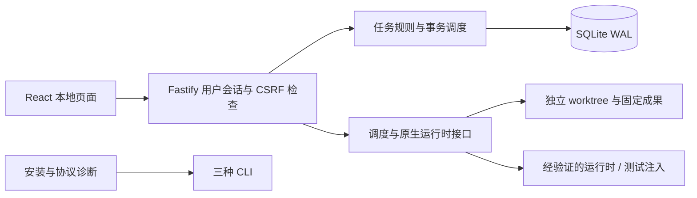

# 当前开发版结构

浏览器只连接同源服务。服务仅监听回环地址，检查 Host、Origin 与请求来源，再检查本机会话；写操作另检查 CSRF。用户专用 API 没有给 agent 提供同权限的凭据。

Core 使用 SQLite 事务保存任务、执行、事件与 outbox。重复请求以稳定请求编号和内容摘要判断；同编号不同内容拒绝。非终态执行在恢复时先进入待核实，排队项则保留待发送状态。暂停、档案停用、并发占用和派发在事务边界裁决。

任务负责人对应角色档案，执行保存档案及规则快照。已确认规则按项目与角色范围筛选；讨论保留来源，不自动升级为派单或长期配置。原生结束证据、成果保存和用户验收是不同的状态变化。

Git 层检查真实路径和提交基准，为写执行创建独立 worktree。成果包含固定文件快照、二进制差异和 SHA-256 清单；读取、复核与验收都要与数据库记录的清单哈希核对。符号链接、子模块和超限成果在当前版本明确拒绝。快照文件本身不等于可靠的进程只读隔离，真实复核还需要原生工具落实权限。

适配器层目前提供 JSON-RPC stdio 传输、安装探测和初始化诊断。服务的运行时接口通过依赖注入连接；测试夹具仅在测试中注入，生产启动不会自动启用。协议握手成功不等于具备真实执行、只读、停止或恢复能力。

SQLite 内建驱动需要 Node 24。配置与数据根目录在进程启动时确定；所有状态与成果保存在本机。传给原生 agent 的内容可能随模型调用离开本机，不能以本地存储代替第三方工具的数据策略。
